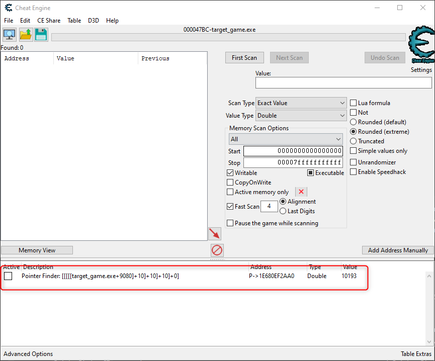
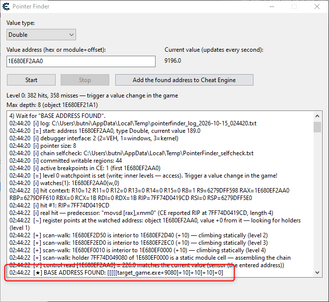
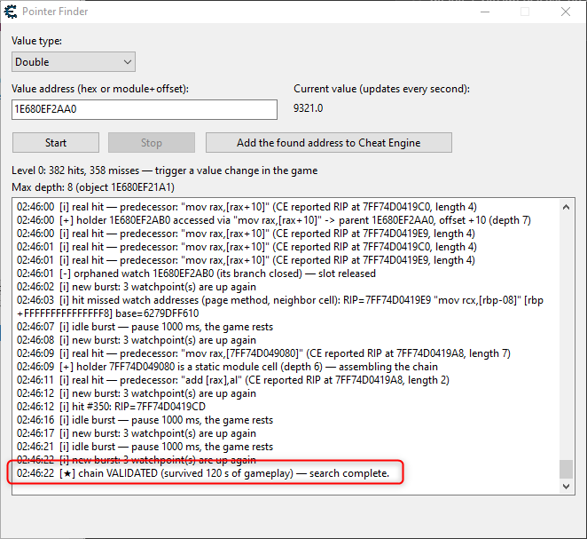

# Cheat Engine Base Address Pointer Auto Finder

**English** | [Русский](README.ru.md)

**Pointer Finder** is a universal Lua tool shipped as a single Cheat Engine
table (`PointerFinder.CT`). It automatically discovers a **stable base
address** — a module-anchored pointer path such as
`game.exe+9080` → `+10` → `+10` → `+10` → `+0` — for any value you found
with CE's memory scanner, and adds a ready-made pointer record to the CE
address list.

> This is for **single-player / offline games** and education. Using memory
> editors in online games usually violates the terms of service and anti-cheat
> systems. Use at your own risk.





## Why

In games with garbage-collected or moving allocations, the address you find
with a scan dies within seconds. The classic manual routine — *find what
writes this address → find what points to the writer's object → repeat until
you reach a static address* — is tedious and error-prone. Pointer Finder
automates the whole walk, and when the world collapses mid-search (the garbage collector moved
the nodes, the address was a dead stack copy, a chain turned out to be a
false lead) it recovers on its own instead of asking you to start over.

## Quick start

1. Start your game and attach Cheat Engine to it.
2. Open `PointerFinder.CT` in CE. The tool window appears. (To reload after
   an update without reopening CE: Lua Engine (Ctrl+Alt+L) → `abfReload()` → Execute.)
3. Find your value with CE's scanner (Double for most currencies) and paste
   the address into the tool. Press **Start**.
4. Keep playing — trigger the value to change. **Rule of thumb: once every
   5–10 seconds is enough.** Rapid-fire changes add nothing: the tool needs
   only a tick to climb or to verify a candidate, and a brief pause between
   changes lets the value settle before verification reads it. In fact, a
   good strategy is to **trigger the change once and just keep waiting** —
   the tool usually climbs the whole chain and verifies the pointer on its
   own, no extra triggers required.
5. Wait for `BASE ADDRESS FOUND`. The pointer record is added to the address
   list immediately as `Pointer Finder (120s check): …` — during the first
   two minutes the tool re-checks the chain against the live value; when it
   holds, the record is renamed to the final `Pointer Finder: …` (black).
   A chain that stops following the value is kept but marked
   `Pointer Finder (WRONG?): …` (grey) — so you can verify it yourself.

Any address from your scan works — even a dead one:

- **Stack copy?** The tool uses it only as a change sensor and scans memory
  for the real storage right after the next value change (fresh-scan mode).
- **Address died mid-search?** A watchdog re-finds live copies of the value
  and continues from them.
- **A chain looks plausible but reads the wrong value?** Every candidate
  chain is verified against the *current* value before being accepted;
  false leads are rejected and the search continues.

## What you get

One pointer record anchored to the module, e.g.:

```
Description: Pointer Finder: [[[[[target_game.exe+9080]+10]+10]+10]+0]
Address:     target_game.exe+9080
Offsets:     0, 10, 10, 10
Type:        Double
```

The tool self-verifies the record step by step (both the resolved address and
the value) and prints the check into the log. A raw-address backup record is
created only if your CE build fails to evaluate module expressions.

**Logs** (handy when reporting an issue): every **Start** writes a fresh
`pointerfinder_log_YYYY-MM-DD_HHMMSS.txt` into your `%TEMP%` folder — open it
with `Win+R` → `%TEMP%`. The chain verification dump lives next to it as
`PointerFinder_selfcheck.txt`. Rejected chains are kept in the address list
marked `(WRONG?)` so you can double-check them yourself.

## How it works

1. A hardware write-watchpoint is placed on your address (classic
   "find what writes").
2. From the writer's instruction the tool recovers the object that owns the
   field — including the `mov rax,[rax+10]` list-traversal case, where the
   base register is reloaded by the very instruction that hit.
3. It then climbs level by level with two independent discovery methods:
   a memory scan for pointers to the current object finds holder cells one
   level up, and a partial-pattern scan resolves the parent node of an
   interior holder cell. Where the system delivers read-watchpoints, holder
   cells are also watched for the game reading them.
4. The found chain is saved as a CE pointer record and re-checked by CE
   itself against the live value every few seconds.

The search runs in short bursts so the game stays playable, and self-heals
across GC rebuilds, dead addresses, and watchpoint budget pressure.

## Value types

Any numeric CE type: **Byte, 2 Bytes, 4 Bytes, 8 Bytes, Float, Double**,
plus **Custom** (1–8 bytes, picked next to the type). The default and the
most common choice for currencies is Double.

## Requirements

- Cheat Engine **7.4+** (tested on 7.7), 64-bit games
- The table is self-contained: the whole tool is embedded in the .CT file

## Known limitations

The tool finds a chain only if one **exists**: every level of the chain is a
pointer stored somewhere in memory, and the chain ends at a static address
inside the game module (`game.exe+offset`). Two cases where this is not true:

- **.NET / Mono games** (e.g. Hades): static "global" values live in the
  runtime's own memory, not in the executable image, so no
  `game.exe+offset` anchor exists. Use Cheat Engine's **Mono features**
  (Mono → Dissect mono structures) to reach static fields instead.
- **Objects stored without pointers** (handle tables, address computed from
  a hash/id): the tool scans for real pointer references; when nothing in
  memory points at the storage object, no chain can be assembled — this is
  a property of the game, not a search failure.

In both cases a manual pointer scan in CE will come up equally empty.

Another variable is **your system, not the game** — and here is an honest
case from development. With Kaspersky installed, attaching the debugger
could hang indefinitely (removing the antivirus fixed that). Hardware
read-watchpoints also stopped being delivered at some point — and this
survived removing the antivirus, a reboot, and disabling Hyper-V, so the
root cause was never pinned down. Pointer Finder v2.10 does not depend on
read-watchpoints: discovery falls back to static pointer scans, and the
tool was verified to work in exactly that degraded state. Practical advice:
add Cheat Engine to your antivirus trusted list (restores fast attach and
watchpoints), and use the status line / log — they show which mode you are
in.

## Building the table

`PointerFinder.CT` is generated from `pointerfinder.lua`:

```
python make_ct.py          # builds PointerFinder.CT (embeds the tool)
python make_ct.py --dev    # also builds PointerFinder-dev.CT (loads the
                           # .lua from this folder; for development only)
python lua_check.py        # compiles pointerfinder.lua with CE's real Lua 5.3
```

`lua_check.py` looks for CE's `lua53-64.dll` in the standard install
locations; set the `CE_DIR` environment variable if your Cheat Engine
lives elsewhere.

## Demo target (`testtarget/`)

`testtarget/` contains a tiny fake game with a 5-level pointer chain where
**every level shows its own number** — ideal for verifying the tool (and your
CE build) end to end. See [testtarget/README.md](testtarget/README.md).

## Lua API

Exposed globals (handy for automation):

| Function | Purpose |
|---|---|
| `abfReload()` | stop and re-load the tool |
| `abfStart(addr, typeName)` | start a search programmatically |
| `abfStatus()` | current status line |
| `abfStop()` | stop the search, release all breakpoints |

## License

[PolyForm Noncommercial 1.0.0](LICENSE) — free for personal, educational and
any other **noncommercial** use. Any **commercial** use (embedding the tool or
its code into a product, paid services, distributions that charge money)
requires a separate license from the author — open an issue or write to
but.nikolay@gmail.com.

Found it useful? A GitHub Sponsor star keeps development going:
[github.com/sponsors/mflow42](https://github.com/sponsors/mflow42).

Again: single-player games only.
